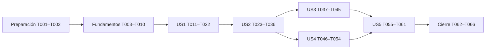

# Tasks: Gestión de proveedores y facturas de proveedores

**Input**: `specs/013-gestion-proveedores/` — spec, plan, research, data-model, contracts y quickstart.
**Fecha**: 2026-10-16 · **Rama**: `013-gestion-proveedores`.
**Prerequisites**: [plan.md](plan.md), [spec.md](spec.md), [research.md](research.md), [data-model.md](data-model.md), [contratos](contracts/README.md), [quickstart.md](quickstart.md), `AGENTS.md` y Constitución vigente.

**Tests**: incluidos por las exigencias de concurrencia/testing y aceptación de la feature y su plan aprobado. Escribir los casos de cada historia antes de implementarla y observar su fallo por la conducta faltante; no falsear locks/constraints con EF InMemory ni reescribir aserciones antiguas para ocultar regresiones.

**Organization**: ocho fases: preparación, fundamentos, cinco historias P1 y cierre. Toda ruta es relativa a la raíz. Los nombres de archivos nuevos son destinos de implementación; no afirman que existan todavía.

**Continuación 2026-10-16**: T001–T010 completas tras revisar la implementación existente, sin rehacer tareas. T008 verificada ejecutando el coordinador real contra `.\SQLEXPRESS02`, base `GtLogistica`, con autenticación Windows: orden global/CUIT normalizados únicos, espera entre conexiones, liberación en commit/rollback y rechazo de retorno negativo. Migración `20261016162244_Modulo13Proveedores` ya aplicada; sin migraciones pendientes ni diferencias modelo/snapshot. No se modificaron datos, producción ni tests para adaptar el entorno. Checkpoint de fundamentos alcanzado; T011–T066 sin iniciar. Sin Docker ni commit. Evidencia y límites en [quickstart.md](quickstart.md#continuación-del-checkpoint-de-fundamentos-2026-10-16).

**Continuación US1 2026-10-16**: T011–T022 implementadas. Pruebas T011–T014 escritas antes del código; fallos iniciales por tipos/pantallas ausentes. Backend compila, unitarias afectadas 18/18; suite completa 516/518 con únicamente los dos fallos previos de Reportes. Frontend build/lint aprobados y 500/500 tests. Verificación SQL independiente sobre instancia local y base temporal aislada aprobada; las suites de integración del fixture original compilan pero sus 33 casos seleccionados quedan bloqueados antes de aserciones por falta de GT_SQL_PASSWORD. No se adaptó el fixture ni producción al entorno. Dependencia mínima para que T022 sea operable: sembrado de gestionar y entrada de padrón solamente; T058 sigue pendiente para el resto y sus pruebas de permisos. T023–T066 no se iniciaron. Evidencia, archivos y límites en [quickstart.md](quickstart.md#administración-de-proveedores-us1-2026-10-16). Sin Docker ni commit.

## Format: `[ID] [P?] [Story] Description`

**Continuación US2 2026-10-16**: T023–T036 completadas para Proveedor normal Activo. T023–T026 escritas antes del código y observadas en fallo por tipos/componentes ausentes; T035 amplió recorridos de memoria, precisión y negativos. Build backend Release (Debug bloqueado por el backend local en ejecución), build/lint frontend aprobados; unitarias de Proveedores 41/41 y completas 539/541, con sólo los dos fallos previos de Reportes. Frontend completo 523/523 con cuatro workers. Los 18 casos del fixture original T024/T036 compilan pero no ejecutan aserciones por falta de GT_SQL_PASSWORD; no se modificó su infraestructura. Verificación independiente de API/DI/multipart/cookies/PDF y SQL real en base/volumen aislados aprobada, con sesión de único permiso cargar, duplicados simultáneos y los seis CHECK. Se habilitaron sólo la carga y las lecturas mínimas de resultado/PDF necesarias para T034, con permisos independientes; sin listado de facturas. T037 no iniciada; Fletero bloqueado, sin pagos ni órdenes de pago, sin cambios de esquema, Docker ni commit. Inventario y evidencia en [quickstart.md](quickstart.md#carga-de-factura-normal-us2-2026-10-16).

`[P]` identifica trabajo en archivos independientes dentro del mismo bloque, una vez completadas sus dependencias. Las tareas de historia llevan `[US1]` a `[US5]`; preparación/fundamentos/cierre no llevan historia. Un permiso declarado no habilita una ruta hasta implementar su política; no publicar incrementos sin autorización.

## Phase 1: Setup — Preparación

**Objetivo**: fijar contratos compartidos y preparar el entorno de prueba existente, sin añadir bibliotecas ni modificar compose.

- [X] T001 Definir los tipos base de Proveedores y Facturas según `contracts/README.md` en `frontend/src/modules/proveedores/servicios/tipos.ts`, incluidos detalle POST, estados camelCase, página de 20 y metadata pública sin ruta física; usar los documentos aprobados sin ampliar campos funcionales. Definir ImporteDecimal como tipo semántico basado en string para todos los importes HTTP, incluidos liquidación disponible/histórica/actual y errores, con exactamente dos decimales; nunca number para importes completos.
- [X] T002 Preparar fixtures reutilizables en `backend/tests/GT.IntegrationTests/Proveedores/EscenarioProveedores.cs` sobre `Infraestructura/AplicacionDePrueba.cs`: proveedores normales/Fleteros, CUIT válidos, empresa emisora y liquidaciones reales; usar bases aisladas y dos DbContext sincronizados, sin sleeps ni credenciales en código.

## Phase 2: Foundational — Fundamentos bloqueantes

**Objetivo**: entidades y garantías compartidas, política y persistencia listas antes de implementar recorridos. No recrear autenticación, almacén ni infraestructura de tests.

- [X] T003 Crear `backend/src/GT.Domain/Proveedores/Proveedor.cs` y `TipoProveedor.cs` con Id `int identity, PK`, Tipo «Fletero o ProveedorNormal; JSON fletero / proveedorNormal», Activo «Estado propio; default true con HasSentinel(true)», Version bigint «Inicial 1; incrementa cada edición/cambio de estado efectivo». TransportistaId «Obligatorio Fletero, nulo normal»; identidad/contacto propios nulos para Fletero, sin copiar Transportistas.
- [X] T004 Crear `backend/src/GT.Domain/Proveedores/FacturaProveedor.cs` y `EstadoFacturaProveedor.cs`: ProveedorId «Proveedor existente Activo al registrar», TipoProveedorAlRegistrar «Congelado, independiente del tipo actual», snapshot razón social/CUIT «Snapshot FR-019, sólo identificación; sin contacto copiado», Numero «Trim; conservar ceros y separadores», Detalle/Cae «No vacíos; sin formato fiscal impuesto», Estado «Únicamente Pendiente, JSON pendiente». No Version de factura ni operaciones de pago/edición/anulación.
- [X] T005 Configurar `backend/src/GT.Infrastructure/Persistencia/Configuraciones/ProveedorConfiguracion.cs`: RazonSocial `nvarchar(200)` nullable, «Obligatoria y no vacía para normal; nula Fletero»; Cuit `varchar(11)` nullable, «Normalizado, válido y obligatorio normal; nulo Fletero»; Telefono `nvarchar(30)` y Email `nvarchar(254)` «Opcionales normal; nulos Fletero; email informado válido»; Direccion `nvarchar(200)` y NombreComercial `nvarchar(max)` opcionales; Activo con HasSentinel(true), Version >0, FK restrict y CHECK por tipo con IS NOT NULL explícitos; índices únicos filtrados de Cuit y TransportistaId, sin filtro por Activo.
- [X] T006 Configurar `backend/src/GT.Infrastructure/Persistencia/Configuraciones/FacturaProveedorConfiguracion.cs`: fechas `date` con «Fecha <= hoy Argentina; vencimiento >= fecha» (hoy se valida en aplicación); Numero `nvarchar(400)` único por ProveedorId; snapshot `nvarchar(200)`/`varchar(11)` NOT NULL; Detalle/Cae `nvarchar` NOT NULL sin límites fiscales; Neto/Iva/ImporteTotal `decimal(18,2)` con «Neto > 0; IVA = ROUND(Neto × 0.21, 2); ImporteTotal = Neto + IVA». LiquidacionId FK restrict «Una obligatoria si tipo histórico Fletero; nula normal» e ImporteLiquidacionAlRegistrar `decimal(18,2)` nullable «Obligatorio con vínculo, coincide con ImporteTotal»; índice único filtrado de LiquidacionId, CHECK Estado=Pendiente y asociación por tipo histórico.
- [X] T007 Completar columnas y CHECK de archivo en `backend/src/GT.Infrastructure/Persistencia/Configuraciones/FacturaProveedorConfiguracion.cs`: «ArchivoRuta nvarchar(400) nullable», «ArchivoNombre nvarchar(255) nullable», «ArchivoTipoContenido nvarchar(100) nullable», HasMaxLength(400/255/100), todos nulos o todos completos, tipo application/pdf e IS NOT NULL antes de comparaciones. Validar sin truncar; no nvarchar(max) por omisión ni datos binarios en SQL.
- [X] T008 Crear el coordinador único en `backend/src/GT.Infrastructure/Persistencia/CoordinadorIdentidadProveedor.cs`: transacción → sp_getapplock Exclusive/Transaction `GT.Proveedores.Identidad` → resolver/normalizar CUIT efectivos anterior/propuesto → recursos `GT.Proveedores.Cuit:<onceDigitos>` únicos en orden ordinal → filas → revalidar → guardar. Mismo principal/base/orden para Proveedor, Transportista y registro de factura; adquirir aunque no exista fila, abortar retornos negativos y liberar sólo en commit/rollback, conservando coordinación global del plan.
- [X] T009 Registrar DbSets/configuraciones en `backend/src/GT.Infrastructure/Persistencia/GtDbContext.cs` y generar migración `Modulo13Proveedores` en `backend/src/GT.Infrastructure/Persistencia/Migraciones/`, verificando SQL de tablas, CHECK, FKs e índices de T005–T007 con snapshot EF; sin precargas ni modificaciones de tablas de pagos. No escribir manualmente un nombre temporal de migración como si fuera el definitivo generado por EF.
- [X] T010 Añadir constantes de los tres permisos en `backend/src/GT.Domain/Usuarios/Rol.cs` y políticas de módulo en `backend/src/GT.Api/Autorizacion/PermisoRequirement.cs`: gestionar, cargar y consultar separados; GET detalle/listado/PDF sólo consultar, POST sólo cargar; OR únicamente para búsqueda mínima de proveedores. Mantener handler por permiso y cookies existentes, sin chequeo de rol ni implicación entre permisos.

**Checkpoint**: T001–T010 completos. Esquema y mecanismos compartidos disponibles, sin rutas de negocio abiertas sin política.

## Phase 3: User Story 1 — Administrar proveedores (P1, primer incremento)

**Goal**: alta, consulta, modificación, baja/reactivación y búsquedas del padrón, sin identidad paralela del Fletero.
**Independent Test**: registrar normal y Fletero, consultar identidad/contacto del origen, buscar por los tres datos, editar, rechazar CUIT duplicado y dar de baja/reactivar conservando datos.

### Pruebas antes de implementación

- [X] T011 [P] [US1] Escribir validaciones de CUIT, email opcional, campos por tipo y cambios de estado en `backend/tests/GT.UnitTests/Proveedores/ReglasProveedorTests.cs`; conservar CUIT propio, rechazar proveedor normal con vínculo/Fletero sin vínculo e impedir que editar reactive silenciosamente.
- [X] T012 [P] [US1] Escribir pruebas SQL de restricciones, capacidades y proyección en `backend/tests/GT.IntegrationTests/Proveedores/PadronProveedorTests.cs`: NULL y texto vacío por separado, Activo=false realmente persistido, Version, identidad/contacto leídos de Transportistas, paginación de homónimos, filtros combinados y proveedor Inactivo conservado.
- [X] T013 [P] [US1] Escribir carreras en `backend/tests/GT.IntegrationTests/Proveedores/ConcurrenciaIdentidadTests.cs`: altas/ediciones normales y Fleteros y modificación de Transportista hacia CUIT normalizado inicialmente ausente, separadores equivalentes, inactivos, orden anterior/nuevo, espera en coordinador aun sin filas y Version obsoleta sin sobrescritura.
- [X] T014 [P] [US1] Escribir recorridos del padrón/formulario en `frontend/src/modules/proveedores/paginas/PadronProveedores.test.tsx`: alta por tipo, contacto de origen no editable, filtros, vacío, baja cancelada/confirmada, reactivación separada y campos conservados ante error. Cubrir búsqueda/paginación del select nativo de Transportista con más de 20 externos: seleccionar el inicialmente 21 o posterior, Anterior/Siguiente, q vuelve a página 1, limpieza de TransportistaId cuando deja el conjunto recibido, carga/vacío/error accesibles y respuesta tardía descartada.

### Implementación

- [X] T015 [US1] Implementar `backend/src/GT.Application/Proveedores/ReglasProveedor.cs` y `DtosProveedor.cs`: normalizar CUIT con reglas existentes, validar capacidades de T005 sin truncar y email sólo informado, exigir externo según empresa emisora para Fletero sin imponer Activo al transportista como nueva regla; resultados con campo/mensaje sin exponer documentación personal.
- [X] T016 [US1] Implementar `backend/src/GT.Infrastructure/Persistencia/RepositorioProveedores.cs` y `backend/src/GT.Application/Proveedores/IRepositorioProveedores.cs`: proyección SQL efectiva para identidad/contacto, búsqueda literal por q/razonSocial/nombreComercial/cuit, tipo/estado, Count/Skip/Take de 20 y orden razón social/Id, AsNoTracking y consulta mínima de externos; no materializar antes de paginar. Externos recibe q/pagina y devuelve página de 20 con total, orden nombre/Id y filtro SQL previo; permite acceder a toda coincidencia sin traer todo el padrón.
- [X] T017 [US1] Implementar transacciones de alta/edición/baja/alta en `backend/src/GT.Infrastructure/Persistencia/RepositorioProveedores.cs` y casos en `backend/src/GT.Application/Proveedores/GestionarProveedores.cs`: usar T008, CHECK/índices como respaldo, Version condicional, bajas confirmadas por UI y reactivación idempotente; relectura de detalle tras commit y traducción de índices a errores de aplicación.
- [X] T018 [US1] Integrar el protocolo exacto de T008 y rechazo de CUIT efectivo duplicado en `backend/src/GT.Infrastructure/Persistencia/RepositorioTransportistas.cs` y su resultado en `backend/src/GT.Application/Choferes/Transportistas/ModificarTransportista.cs`; comprobar también cuando aún no hay vínculo, preservar contactos/dependencias y la traducción IX_Transportistas_Cuit; no actualizar filas de Proveedores al editar contacto de origen (FR-037.1).
- [X] T019 [US1] Implementar rutas de padrón, baja/alta y externos de contratos en `backend/src/GT.Api/Proveedores/ProveedoresEndpoints.cs` y DI/mapeo en `backend/src/GT.Api/Program.cs`: restricciones `{id:int}`, gestionar requerido, JSON camelCase, página inválida 400, datos/duplicados 400, Version/estado cambiado 409, 401/403/404 existentes.
- [X] T020 [US1] Implementar servicio HTTP de padrón en `frontend/src/modules/proveedores/servicios/proveedores.ts` y `paginas/PadronProveedores.tsx`: buscador/filtros visibles, orden y resumen, páginas de 20, estados de carga/error/vacío, enlace de fila real y menú siempre enfocable; sólo Nuevo proveedor primario.
- [X] T021 [US1] Implementar `frontend/src/modules/proveedores/paginas/FormularioProveedor.tsx` y `DetalleProveedor.tsx`: controles por tipo de T015, lectura del origen para Fletero, Campo y estados de plan, secciones/barra viewport, Version no visual, cancelar/confirmar baja y reactivación separada; salir del alta al detalle sin duplicar identidad ni modificar textos de otros módulos. Para Transportista usar input q más select nativo poblado sólo con página actual de 20 y Anterior/Siguiente; cambiar q vuelve a página 1, limpiar Id si queda fuera del conjunto recibido y no guardar selección desactualizada. En edición iniciar q con CUIT actual; estados accesibles y sin precarga ni autocomplete de proveedores.
- [X] T022 [US1] Registrar rutas protegidas del padrón en `frontend/src/App.tsx` y validar T011–T014 junto a la regresión existente de Transportistas en `backend/tests/GT.IntegrationTests/Choferes/`; dejar operable el incremento sólo con gestionar, sin otorgarle carga/consulta de facturas por implicación.

## Phase 4: User Story 2 — Cargar factura recibida, GFP_01 (P1)

**Goal**: carga de proveedor normal con neto positivo, cálculo correcto, PDF opcional y resultado completo del POST. La carga Fletero se termina en US3; no habilitarla sin su liquidación obligatoria durante este incremento.
**Independent Test**: seleccionar normal activo por CUIT, neto $100.000,00 → IVA $21.000,00 → total $121.000,00, guardar y ver Pendiente desde DTO del POST sin GET; rechazar campos/fechas/archivo inválidos.

### Pruebas antes de implementación

- [X] T023 [P] [US2] Escribir `backend/tests/GT.UnitTests/Proveedores/ReglasFacturaProveedorTests.cs` para neto obligatorio >0, dos decimales/capacidad, IVA comercial, total, fechas con hoy Argentina por parámetro, vencimiento igual permitido y CAE antiguo aceptado; incluir $0,50→$0,11→$0,61 y $0,01→$0,00→$0,01. Añadir valores grandes 100000000000000.01 y 100000000000000.02 y verificar que decimal, cálculo y validación los distinguen sin topes comerciales adicionales.
- [X] T024 [P] [US2] Escribir `backend/tests/GT.IntegrationTests/Proveedores/CargarFacturaProveedorTests.cs` para POST multipart completo, número repetido por proveedor y simultáneo, mismo número en otro proveedor, baja/edición concurrente, snapshot histórico, Estado Pendiente, archivo real y respuesta 201 con todos los campos del detalle. Probar ida y vuelta multipart→decimal→POST con cada importe como cadena canónica F2 invariant, distinguiendo 100000000000000.01 y 100000000000000.02; rechazar JSON number para entradas monetarias de 013 donde aplique, sin double ni redondeo de entradas inválidas.
- [X] T025 [P] [US2] Escribir fallos de escritura/SQL/compensación/relectura en `backend/tests/GT.UnitTests/Proveedores/AtomicidadFacturaProveedorTests.cs`: rechazo después de PDF borra con CancellationToken.None; postcommit no borra; commit incierto verifica referencia y, si no puede, conserva archivo; fallo de borrado sólo huérfano invisible.
- [X] T026 [P] [US2] Escribir `frontend/src/modules/proveedores/componentes/AutocompleteProveedor.test.tsx` para razón social/nombre comercial/CUIT, sólo activos, texto sin Id, teclado, respuestas tardías, limpieza y siguientes resultados paginados; sin mínimo nuevo de caracteres ni precarga de padrón.

### Implementación

- [X] T027 [US2] Implementar `backend/src/GT.Domain/Proveedores/ReglasFacturaProveedor.cs` y `backend/src/GT.Application/Proveedores/DtosFacturaProveedor.cs`: validaciones T023, reutilizar IVA de Facturacion con 21%, Neto/Iva/ImporteTotal decimal(18,2), Número nvarchar(400) con trim y ceros intactos, Detalle/Cae obligatorios, fechas DateOnly, calculados/estado/snapshots no editables y Fletero sin liquidación rechazado desde el comienzo. Mantener decimal en DTO internos; adaptar sólo el borde HTTP de 013 a cadenas canónicas de exactamente dos decimales, según contratos, sin alterar serialización global.
- [X] T028 [US2] Implementar `backend/src/GT.Application/Proveedores/PrepararPdfFacturaProveedor.cs` reutilizando IValidadorDeArchivo/IAlmacenDeArchivos: firma application/pdf, límite 10×1024×1024, nombre generado, capacidades ArchivoRuta(400)/ArchivoNombre(255)/ArchivoTipoContenido(100), validación sin truncar y escritura completa previa a SQL; no admitir imágenes ni crear subida separada.
- [X] T029 [US2] Implementar `backend/src/GT.Infrastructure/Persistencia/RepositorioFacturasProveedor.cs` e interfaz `backend/src/GT.Application/Proveedores/IRepositorioFacturasProveedor.cs`: T008 antes de proveedor Activo, UPDATE sin cambio y relectura de tipo/identidad efectivos; guardar snapshot y registro completo, índice proveedor/número y traducción de rechazo, sin aceptar asociación para normal ni dejar factura parcial.
- [X] T030 [US2] Implementar orquestación en `backend/src/GT.Application/Proveedores/CargarFacturaProveedor.cs`: validación → PDF → transacción de T029 → commit → relectura interna completa; compensar en todo rechazo/excepción precommit y resolver incertidumbre según research §5 sin borrar un PDF confirmado; la relectura interna no exige consultar ni llama un GET HTTP.
- [X] T031 [US2] Implementar POST multipart y resultados en `backend/src/GT.Api/Proveedores/FacturasProveedorEndpoints.cs`, `RespuestasProveedor.cs` y `backend/src/GT.Api/Program.cs`: sólo cargar, 201 con detalle completo y Location, cliente no impone calculados discordantes, formatos invariant culture, errores de campo/estado y sin información técnica; usar cookies y protección multipart existentes. Añadir serialización/deserialización monetaria exacta y local al módulo en backend/src/GT.Api/Proveedores/ImporteDecimalJsonConverter.cs: decimal↔cadena canónica F2 invariant, sin double ni converter global; incluir todos los importes de POST, GET, disponibles y errores de conflicto.
- [X] T032 [US2] Añadir búsqueda mínima paginada en `backend/src/GT.Api/Proveedores/ProveedoresEndpoints.cs` usando T016, autorizada gestionar OR cargar OR consultar, con `soloActivos` bool? y `?? false`, sin contacto/dirección/documentos; crear `frontend/src/modules/proveedores/componentes/AutocompleteProveedor.tsx` reutilizable localmente, debounce 250 ms, Id separado, teclado/aria/status y descarte de respuestas anteriores.
- [X] T033 [US2] Implementar petición FormData y preview de importes en `frontend/src/modules/proveedores/servicios/facturasProveedor.ts` y `importesFactura.ts`: neto puro en invariant culture sin miles, IVA exacto en centavos/cadenas o BigInt dentro de toda capacidad decimal, sin punto flotante aproximado ni biblioteca nueva; usar moneda/fechas compartidas. Definir ImporteDecimal string y parsing/formato exactos sin Number/parseFloat del valor completo; ampliar frontend/src/compartido/moneda.ts con sobrecarga de cadena exacta preservando callers number (AGENTS [005]), sin convertir cadena a number. Añadir casos en frontend/src/modules/proveedores/servicios/importesFactura.test.ts y frontend/src/compartido/moneda.test.ts para 100000000000000.01 y 100000000000000.02, parseo, preview, formato y errores; no cambiar aserciones previas.
- [X] T034 [US2] Implementar frontend/src/modules/proveedores/paginas/CargarFacturaProveedor.tsx, DetalleFacturaProveedor.tsx y componentes/ResultadoFacturaContexto.tsx con contexto/store local montado sobre ambas páginas, estrictamente en memoria del runtime React. Tras POST guardar sólo último DTO con Id y navegar por URL a /proveedores/facturas/{id}, sin DTO en location.state/history.state. Si Id coincide mostrar sin GET; si falta/difiere ejecutar GET que exige consultar. Recarga completa pierde necesariamente memoria y con sólo cargar recibe 403. Prohibir localStorage, sessionStorage, IndexedDB y persistencia equivalente; limpiar al cerrar/cambiar sesión. Mantener campos/estados/secciones/InputImporte, importes string exactos y PDF opcional; salir del alta, no ofrecer PDF sin consultar. Normal sin liquidación y Fletero bloqueado hasta US3.
- [X] T035 [US2] Registrar la ruta de carga/resultado en `frontend/src/App.tsx` y pruebas de recorrido en `frontend/src/modules/proveedores/paginas/CargarFacturaProveedor.test.tsx`: sin selección, neto vacío/cero/negativo, límites de fecha Argentina con sólo Date falseado, formato, error recuperable conserva valores y POST exitoso no dispara GET. Probar runtime de memoria nuevo en recarga completa y coincidencia/no coincidencia de Id del resultado, con spies de POST/GET; DTO nunca va a estado del router ni almacenamiento persistente.
- [X] T036 [US2] Validar la integración real multipart/DI y restricciones de T006–T007 en `backend/tests/GT.IntegrationTests/Proveedores/CargarFacturaProveedorTests.cs`, junto con T023–T026/T035; cubrir PDF renombrado, límites de tamaño/metadata, CHECK con NULL y duplicados simultáneos sin fila parcial. No declarar carga Fletero completa hasta US3.

## Phase 5: User Story 3 — Asociar liquidación obligatoria del Fletero (P1)

**Goal**: completar carga de Fletero con exactamente una Pendiente disponible y total idéntico, sin registrar pagos ni bloquear operaciones posteriores.
**Independent Test**: elegir Fletero, ver sólo liquidaciones de su transportista, asociar $121.000,00 a neto $100.000,00; faltar selección o diferir un centavo impide guardar.

### Pruebas antes de implementación

- [x] T037 [P] [US3] Escribir `backend/tests/GT.IntegrationTests/Proveedores/AsociarLiquidacionTests.cs` para selección obligatoria, pertenencia/condición externa, Pendiente libre, normal con asociación rechazado, igualdad exacta y ausencia de disponibles; pagos parciales siguen elegibles y se compara total, no saldo. Verificar total de disponibles, importeLiquidacionAlRegistrar/importeAlRegistrar, importeActual e importes de conflictos como cadenas canónicas; conservar centavos distintos en valores grandes.
- [x] T038 [P] [US3] Escribir `backend/tests/GT.IntegrationTests/Proveedores/ConcurrenciaLiquidacionFacturaTests.cs`: dos facturas misma liquidación, asociación contra edición/anulación/pago total/parcial, locks compartidos con Módulo 9, revalidación tras espera, rollback de factura/vínculo y PDF compensado; cambios posteriores no reescriben factura ni agregan restricciones.
- [x] T039 [P] [US3] Escribir `frontend/src/modules/proveedores/paginas/CargarFacturaFletero.test.tsx` para selección obligatoria/disponibles, sin disponibles no guarda, cambio de proveedor limpia selección y total distinto muestra ambos importes del servidor sin confirmación que saltee validación. Verificar presentación de importeTotalFactura/importeTotalLiquidacion canónicos sin convertirlos a number y distinguir sus centavos en valores grandes.

### Implementación

- [x] T040 [US3] Implementar proyección y caso de disponibles en `backend/src/GT.Infrastructure/Persistencia/RepositorioFacturasProveedor.cs` y `backend/src/GT.Application/Proveedores/ConsultarLiquidacionesDisponibles.cs`: Pendientes del Transportista vinculado, libres de factura, número visible de NumerosVisibles/período/total; normal colección vacía, sin documentos ni permiso de Liquidaciones heredado. El endpoint nuevo adapta importes internos decimal a ImporteDecimal string, incluidos total disponible e histórico/actual; no reutilizar una respuesta numérica del Módulo 9.
- [x] T041 [US3] Completar transacción en `backend/src/GT.Infrastructure/Persistencia/RepositorioFacturasProveedor.cs`: coordinador común → proveedor → Transportista/lectura estable empresa emisora → UPDATE condicionado de Liquidacion por Id/Transportista/Pendiente → releer total y disponibilidad → insertar factura con FK y snapshot. Verificar afectadas, índice único filtrado y monto exacto; no modificar Estado/total/pagos de liquidación (FR-037.2).
- [x] T042 [US3] Integrar validaciones y conflicto 409 en `backend/src/GT.Application/Proveedores/CargarFacturaProveedor.cs` y `backend/src/GT.Api/Proveedores/FacturasProveedorEndpoints.cs`: «exactamente una» liquidación para Fletero, ninguna normal, total actual igual a factura; mensaje armado con importeTotalFactura/importeTotalLiquidacion, sin ajustar neto ni aceptar confirmado como excepción.
- [x] T043 [US3] Mapear GET `/{id:int}/liquidaciones-disponibles` sólo con cargar en `backend/src/GT.Api/Proveedores/ProveedoresEndpoints.cs` e integrar consulta en `frontend/src/modules/proveedores/servicios/facturasProveedor.ts`; diferenciar 400/409/404 según contrato, sin endpoint o permiso de pago nuevo.
- [x] T044 [US3] Completar selector nativo de liquidación en `frontend/src/modules/proveedores/paginas/CargarFacturaProveedor.tsx`: número/período/total, required sólo Fletero, limpieza al cambiar proveedor, carga/vacío/conflicto anunciados y bloqueo de guardar sin disponibles; conservar datos del operador y usar importes recibidos del servidor.
- [x] T045 [US3] Ejecutar T037–T039 y regresión existente en `backend/tests/GT.IntegrationTests/Liquidaciones/`, verificando también T024/T025/T035; confirmar que el PDF, fila y vínculo son todo o nada, la liquidación asociada deja de ofrecerse y sus operaciones posteriores conservan sus reglas.

**Estado US3 (2026-10-17)**: T037–T044 completas. T045 parcialmente validada: unitarios afectados 71/71, frontend completo 530/530, build/lint y doce escenarios SQL/HTTP independientes aprobados en base local aislada. Queda pendiente la regresión SQL original: 120 casos bloqueados en preparación por el fixture exclusivo de compose/sa/GT_SQL_PASSWORD, sin adaptación artificial. Sólo los dos fallos previos de Reportes en unitarios completos (539/541). Evidencia e inventario en quickstart.md, apartado US3. T046 no iniciada; sin pagos nuevos, Docker ni commit.

## Phase 6: User Story 4 — Consultar facturas, GFP_02 (P1)

**Goal**: listado filtrable, detalle histórico y PDF protegido; proveedor de filtro incluye activos e inactivos.
**Independent Test**: combinar fechas inclusivas/proveedor/Pendiente, abrir detalle y PDF, dar de baja/editar origen y seguir encontrando el comprobante con identificación e importes históricos.

### Pruebas antes de implementación

- [x] T046 [P] [US4] Escribir `backend/tests/GT.IntegrationTests/Proveedores/ConsultarFacturasProveedorTests.cs`: fechas en cuatro bordes y rangos abiertos/invertidos, proveedor por Id y estado excluyente, paginación estable, snapshot tras cambio de tipo/CUIT/nombre, liquidación histórica y actual, PDF inline/nosniff sin ruta física. Probar ida y vuelta de GET listado/detalle, liquidación histórica/actual/disponible y conflictos con cadenas de dos decimales, manteniendo distintos 100000000000000.01 y 100000000000000.02 y verificando ausencia de tokens JSON number para importes.
- [x] T047 [P] [US4] Escribir `frontend/src/modules/proveedores/paginas/ConsultarFacturasProveedor.test.tsx`: autocomplete con inactivos, filtros combinados y limpiar, vacío inicial vs sin coincidencias, 20 filas, enlace real y errores/estados accesibles.
- [x] T048 [P] [US4] Escribir frontend/src/modules/proveedores/paginas/DetalleFacturaProveedor.test.tsx para GET con consultar y resultado de POST desde contexto React en memoria con Id coincidente sin GET; Id ausente/distinto dispara GET, recarga completa con runtime nuevo pierde DTO y con sólo cargar obtiene 403. Verificar que nunca se guarda DTO en location.state/history.state ni localStorage/sessionStorage/IndexedDB; importes string exactos, campos históricos, PDF ausente y distinción por tipo histórico, sin enlaces de módulos ajenos sin permiso.

### Implementación

- [x] T049 [US4] Implementar consultas en `backend/src/GT.Infrastructure/Persistencia/RepositorioFacturasProveedor.cs` y `backend/src/GT.Application/Proveedores/ConsultarFacturasProveedor.cs`: desde/hasta inclusivos sobre Fecha DateOnly, proveedor exacto y Pendiente, filtros SQL antes de Count/Skip/Take, 20 filas orden fecha DESC/Id DESC, detalle completo con snapshot y estado/importe actual de liquidación sin reemplazar histórico. Mantener decimal en consulta/modelo y serializar importes como cadenas canónicas sólo en borde HTTP de 013, sin alterar datos históricos ni contratos de otros módulos.
- [x] T050 [US4] Implementar `backend/src/GT.Application/Proveedores/AbrirPdfFacturaProveedor.cs` y GET listado/detalle/archivo en `backend/src/GT.Api/Proveedores/FacturasProveedorEndpoints.cs`: todos exclusivamente consultar, reusar ResultadoArchivo.EnLinea y almacén privado; nombre original, application/pdf y nosniff, 404 sin archivo y ninguna ruta física expuesta.
- [x] T051 [US4] Implementar listado/filtros con servicios de consulta en `frontend/src/modules/proveedores/paginas/ConsultarFacturasProveedor.tsx` y `servicios/facturasProveedor.ts`: autocomplete T032 con soloActivos=false, rango/estado, resumen de filtros, formato ARS/fechas, páginas y vacíos distintos; sin primario artificial ni exportación. Renderizar importes contractuales ImporteDecimal string mediante formato exacto, sin Number/parseFloat del valor completo; añadir casos grandes que conserven el centavo distinto.
- [x] T052 [US4] Completar frontend/src/modules/proveedores/paginas/DetalleFacturaProveedor.tsx y componentes/ResultadoFacturaContexto.tsx: leer DTO temporal exclusivamente de memoria React y sólo usarlo si Id coincide; si falta/difiere ejecutar GET aunque sólo tenga cargar, con 403 decidido por backend que exige consultar. Recarga completa destruye DTO, sin rehidratación desde router/storage. Ficha/aside y dinero exacto como string, histórico/actual separados; PDF sólo consultar. Integrar proveedor del contexto sobre carga/detalle en frontend/src/App.tsx sin habilitar GET por cargar.
- [x] T053 [US4] Registrar listado y detalle en `frontend/src/App.tsx`, reutilizar permisos de sesión y 403 real en `frontend/src/modules/proveedores/paginas/ConsultarFacturasProveedor.tsx` y `DetalleFacturaProveedor.tsx`; referencia a Proveedores/Liquidaciones sólo si sus propios permisos lo permiten, sin inventar permisos por tener el Id. La ruta de detalle permite renderizar el contexto temporal con Id coincidente; si falta/difiere siempre ejecuta GET y deja que consultar se exija en backend, incluso para sólo cargar que recibirá 403.
- [x] T054 [US4] Validar T046–T048 y los escenarios GFP_02 de `specs/013-gestion-proveedores/quickstart.md`, incluidas facturas de origen Inactivo y liquidación cambiada después del registro; comprobar que consultas no introducen edición, estados futuros ni generación de comprobantes.

**Estado US4 (2026-10-17)**: T046–T054 completas. Pruebas T046–T048 escritas/ejecutadas primero; listado SQL paginado con filtros, detalle histórico y PDF autorizado implementados. Unitarios afectados 41/41; backend completo 539/541 con sólo los dos fallos previos de Reportes. Frontend afectado 47/47 y completo 540/540; build backend Release, build/lint frontend aprobados. Dos escenarios SQL/HTTP nuevos y dos de precisión compartidos aprobados en base local aislada; fixture original de los dos tests nuevos bloqueado por GT_SQL_PASSWORD/sa/compose, sin modificarlo. T045 sigue sin marcar; T055 no iniciada. Sin Docker, pagos nuevos ni commit. Inventario y evidencia en quickstart.md, apartado US4.

## Phase 7: User Story 5 — Acceso restringido (P1)

**Goal**: completar siembra/menú e integrar prueba de aislamiento de permisos para todas las rutas ya protegidas desde fundamentos.
**Independent Test**: sin sesión se exige ingreso; sin permiso no se expone nada; sólo cargar puede POST y ver su respuesta, pero GET detalle/listado/PDF es 403; sólo consultar puede leer y POST es 403; gestionar no implica ninguno de facturas.

### Pruebas antes de implementación

- [x] T055 [P] [US5] Escribir casos de cada permiso aislado en `backend/tests/GT.UnitTests/Autenticacion/CatalogoOpcionesMenuTests.cs`, verificando su única entrada de pantalla y ninguna implicación automática entre códigos de permiso.
- [x] T056 [P] [US5] Escribir matriz de rutas POST/GET/padrón/búsquedas/PDF con cookies en `backend/tests/GT.IntegrationTests/Proveedores/PermisosProveedorTests.cs`: sin sesión 401, permisos faltantes 403, roles sembrados y personalizados aislados; POST devuelve detalle completo con sólo cargar y todos los GET de factura exigen consultar; comprobar siembra idempotente sin otorgar a Tráfico/Gerencia.
- [x] T057 [P] [US5] Escribir `frontend/src/modules/proveedores/paginas/AccesoProveedores.test.tsx` para menú/rutas/acciones permitidas, falta de permiso que indica pedirlo al administrador, destino postalta desde respuesta sin GET y recarga sin estado rechazada; no ofrecer PDF con sólo cargar ni documentos de Choferes por buscar un transportista. Probar recarga completa con un runtime/contexto nuevo: no rehidratar DTO desde location.state/history.state ni storage y verificar GET→403 con sólo cargar; contexto se limpia al cerrar/cambiar sesión.

### Implementación

- [x] T058 [US5] Sembrar explícitamente los tres permisos sólo a Administración de la empresa y Administrador del sistema en `backend/src/GT.Infrastructure/DatosIniciales/SembradorInicial.cs`, conservando asignaciones previas y sin implicaciones entre códigos; registrar únicamente pantallas implementadas en `backend/src/GT.Application/Autenticacion/CatalogoOpcionesMenu.cs`.
- [x] T059 [US5] Integrar agrupación visual Proveedores/Facturas en `frontend/src/compartido/seccionesDeMenu.ts` y revisar guardas de `frontend/src/App.tsx`: servidor decide opciones, desconocidos siguen visibles en fallback, no chequear roles ni usar gestionar de Choferes/Liquidaciones para endpoints mínimos del módulo.
- [x] T060 [US5] Revisar cada RequireAuthorization y política OR mínima de `backend/src/GT.Api/Proveedores/ProveedoresEndpoints.cs`, `FacturasProveedorEndpoints.cs` y `backend/src/GT.Api/Autorizacion/PermisoRequirement.cs`; GET detalle/PDF/listado sólo consultar y POST sólo cargar, sin autorización escondida en handlers ni relectura HTTP que exija consultar al completar POST.
- [x] T061 [US5] Ejecutar T055–T057 y pruebas de menú anteriores; registrar resultados de la matriz aislada en `specs/013-gestion-proveedores/quickstart.md`, confirmando que URI directa, adjuntos y búsqueda mínima están protegidos y que la UI no sugiere reintentar un 403.

**Estado US5 (2026-10-17)**: T055–T061 completas. Tests T055–T057 escritos y ejecutados primero; siembra explícita de los tres permisos sólo a Administración/Administrador, catálogo y agrupación de las pantallas implementadas, auditoría de políticas sin ampliaciones. Unitarios afectados 52/52; completos 543/545 con sólo los dos fallos previos de Reportes. Frontend afectado 63/63 y completo 551/551; build backend Release, frontend y lint aprobados. Matriz SQL/API local aislada aprobada: 10 perfiles, 13 operaciones y 130 estados comprobados, más siembra idempotente con roles personalizados y asignaciones previas conservadas. Once casos del fixture original siguen bloqueados por sa/GT_SQL_PASSWORD/compose; no se modificó su configuración. Evidencia e inventario en quickstart.md, apartado US5. T045 sigue sin marcar; T062 no iniciada. Sin Docker, pagos nuevos ni commit.

## Phase 8: Polish & Cross-Cutting Concerns — Cierre

**Objetivo**: verificar las cinco historias juntas, completar evidencia y mantenimiento transversal; no añadir funcionalidad de pagos ni mejoras fuera de spec.

- [x] T062 Ejecutar `dotnet test` desde backend y `npm test`, `npm run build`, `npm run lint` desde frontend, con evidencia en `specs/013-gestion-proveedores/quickstart.md`; incluir regresión de Transportistas, Liquidaciones, Facturación, adjuntos y menú sin alterar aserciones para esconder cambios ajenos.
- [x] T063 Validar SC-001 con 1.000 proveedores y al menos 100 búsquedas por los tres datos en `specs/013-gestion-proveedores/quickstart.md`: 95% <2 segundos desde fin de escritura, incluyendo debounce/red/render; revisar SQL generado de filtros/paginación y medir antes de añadir índices, sin ampliar scope ni precargar todo el padrón.
- [x] T064 Revisar UI de las seis pantallas contra `specs/013-gestion-proveedores/plan.md`, `.claude/skills/gt-ui/SKILL.md` y `references/tokens.md`: 1280 px, teclado, contraste sobre fondo real, una primaria máxima, required/nombres accesibles y regiones vivas; registrar evidencia en `specs/013-gestion-proveedores/quickstart.md`, sin rediseñar pantallas previas.
- [x] T065 Completar validación manual de GFP_01/GFP_02 y SC-001–SC-007 en `specs/013-gestion-proveedores/quickstart.md`, revisando trazabilidad inferior y sólo los dos cambios de FR-037; confirmar ausencia de Gestión de Pagos, endpoints de edición/anulación de estas facturas, impuestos nuevos y generación fiscal. No marcar validaciones no ejecutadas como aprobadas.
- [x] T066 Actualizar `AGENTS.md` con las decisiones de diseño y convenciones nuevas de esta feature, una línea por decisión, con referencia a la spec (p. ej. ‘[013] ...’). No incluir entradas por incluir: sólo información transversal relevante que puedan aprovechar futuras features; actualizar GT UI únicamente si una corrección transversal autorizada realmente la modifica.

**Estado del cierre (2026-10-17)**: T063 completa: 120 búsquedas reales en Edge sobre 1.000 proveedores; 120/120 <2 s, p95 382,1 ms, máximo 433,6 ms, sin índices nuevos ni precarga. T064 completa: seis tipos de pantalla a 1280 px, teclado/árbol accesible/contraste, estados y correcciones locales verificadas. T066 completa: dos decisiones transversales nuevas. T062 ejecutada parcialmente, sin marcar: 543/545 unitarios (sólo los dos fallos previos de Reportes), 552/552 frontend, builds/lint/diff aprobados; 1.021 casos del fixture original bloqueados antes de sus aserciones por GT_SQL_PASSWORD. T045 permanece sin marcar; el runner SQL independiente aporta evidencia adicional y no sustituye esa regresión. T065 completa tras la confirmación del usuario: empleado realizó desde la interfaz, sin herramientas ni asistencia técnica, administración de proveedores, GFP_01 normal/Fletero, cálculo IVA/total, validaciones, GFP_02, PDF y snapshot histórico; SC-005 OK. Evidencia detallada en quickstart.md, sin atribuirle repeticiones técnicas no informadas. Esta actualización modifica exclusivamente quickstart.md/tasks.md; backend/cierre-013.tmp no existe ni forma parte de los cambios. Bases, servicios y temporales propios eliminados; GtLogistica y servicios 5005/5173 conservados. Detalle e inventario en quickstart.md. Sin Docker, funcionalidad de pagos nueva ni commit.

## Dependencies & Execution Order

### Dependencias de fase e historias

Preparación → Fundamentos → US1 → US2 → US3. US4 puede comenzar después de US2 con fixtures propios; su validación completa de liquidaciones espera US3. US5 integra el menú al finalizar rutas de US1–US4, pero T010 protege endpoints desde el comienzo: no posponer autorización hasta el final. Cierre espera US1–US5.

US3 completa el caso Fletero de GFP_01, no una opción que pueda omitirse al entregar. US4 se prueba con registros preparados sin requerir que el operador haya usado el formulario durante esa prueba. US5 se prueba con permisos aislados y fixtures sin depender del orden de sesiones del recorrido anterior.

### Orden dentro de cada historia

Pruebas primero → reglas/proyección → persistencia y casos de uso → endpoint protegido → frontend → validación. Las tareas siguientes a un bloque de pruebas dependen de sus casos definidos. T005–T007 dependen de T003–T004; T009 depende de T005–T007. T018 depende del coordinador T008 y de la proyección T016. T030 depende de T028–T029. T041–T042 completan T029–T030 sin bifurcar el protocolo; T050/T052 conservan la separación POST/GET de T031/T034. T058 depende de todos los endpoints que anuncia y de constantes T010.

### Ejemplos de paralelismo por historia

| Historia | Bloque paralelo permitido | Condición |
|---|---|---|
| US1 | T011, T012, T013, T014 | Fundamentos completos; archivos de pruebas distintos |
| US2 | T023, T024, T025, T026 | US1 validada; no modificar fixtures compartidos simultáneamente |
| US3 | T037, T038, T039 | Base de carga US2 completa |
| US4 | T046, T047, T048 | US2 completa; usar fixtures de liquidaciones para definir casos |
| US5 | T055, T056, T057 | Rutas listas y contratos aislados vigentes |

No paralelizar modificaciones de RepositorioFacturasProveedor, FacturasProveedorEndpoints, CargarFacturaProveedor, DetalleFacturaProveedor, App.tsx o quickstart entre historias: comparten archivos. `[P]` permite escribir pruebas en paralelo, no afirma que una prueba de comportamiento incompleto deba pasar todavía ni autoriza iniciar subagentes automáticamente.

## Implementation Strategy

**MVP recomendado**: preparación + fundamentos + US1, con políticas ya activas y rol autorizado para validar el padrón. Es el primer incremento útil; no constituye la entrega completa pedida de GFP_01/GFP_02. No desplegar menús que anuncien pantallas faltantes ni omitir US5 en una publicación.

Continuar US2 → US3 para GFP_01 completo, luego cerrar US4 y US5. Cada checkpoint ejecuta sus pruebas y permite revisar el recorrido con fixtures propios. La entrega final requiere las cinco historias y T062–T066. No introducir pagos ni cambiar la spec para resolver una implementación más cómoda.

## Trazabilidad y cobertura

| Requisitos | Tareas principales |
|---|---|
| FR-001–FR-009 | T003, T005, T011–T022 |
| FR-010–FR-014 | T004, T006, T023, T027–T035, T037–T044 |
| FR-015–FR-020 | T006–T007, T024–T025, T028–T031, T034–T036, T050 |
| FR-021–FR-025 | T008, T037–T045, T049, T052 |
| FR-026–FR-031 | T046–T054 |
| FR-032–FR-035 | T010, T019, T026, T031–T035, T044, T050–T053, T055–T064 |
| FR-036 | T004, T043, T054, T065 |
| FR-037.1 / FR-037.2 | T013, T018 / T038, T041, T045 |
| SC-001 | T026, T032, T051, T063 |
| SC-002 | T023, T027, T033, T035 |
| SC-003 | T012–T013, T024, T036–T038 |
| SC-004 | T046, T048–T054 |
| SC-005 | T035, T039, T047–T048, T065 |
| SC-006 | T055–T061 |
| SC-007 | T037–T045 |

**Control de alcance**: la generación original de tareas no implementó código. Durante implementación las casillas se marcan sólo con ejecución y verificación reales; el estado y los límites de validación se registran al inicio y en quickstart. No ampliar la spec para completar una tarea.

## Cierre documental final — 2026-10-18

T045 y T062 completas. La validación final informada por el usuario en Arch Linux, con Docker Compose y SQL Server 2022 healthy, aprobó el backend completo (1567/1567, incluidas las pruebas de integración contra SQL Server real), frontend (72 archivos, 552 tests), build y lint (0 warnings, 0 errors). La evidencia final en `quickstart.md` reemplaza los pendientes de las entradas históricas anteriores. Feature 013 cerrada documentalmente; sin cambios adicionales de código ni commit.
